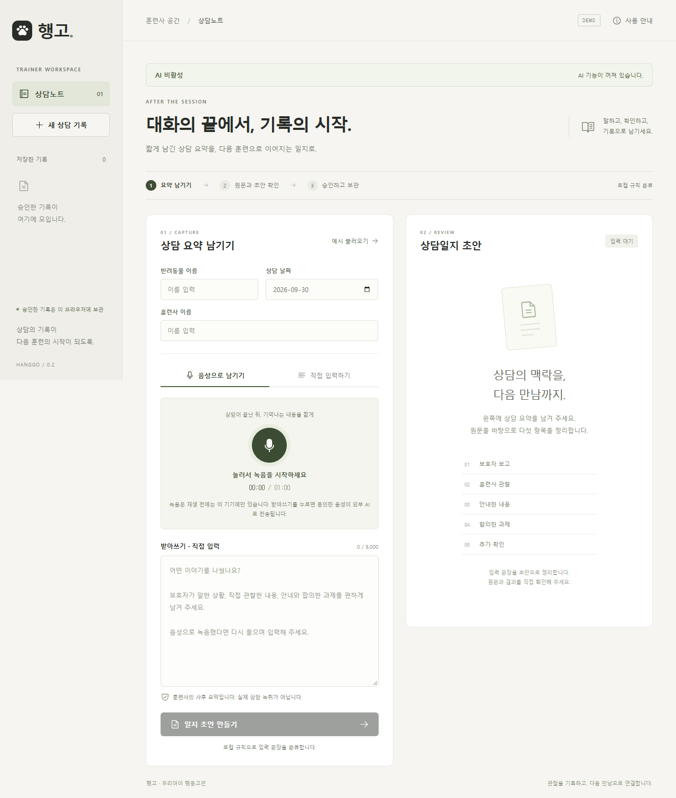
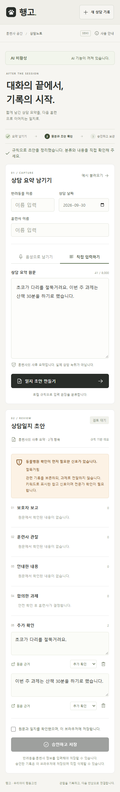

<div align="center">

# 행고 · Hanggo

### 대화의 끝에서, 기록의 시작.

보호자의 일상 기록부터 상담일지와 보호소 프로필까지, 원문 근거로 연결합니다.

[](https://github.com/joon56/Hanggo-LLM/actions/workflows/ci.yml)


[공개 체험판](https://joon56.github.io/Hanggo-LLM/) · [빠른 시작](#빠른-시작) · [브리핑 시연](docs/testing/consultation-brief.md) · [카메라 상담 시연](docs/testing/camera-consultation.md) · [기존 기능 시연](docs/testing/beta-test-script.md)

</div>



## 무엇을 할 수 있나요?

행고는 이 PC에서 Ollama `qwen3.5:9b`로 기록 초안을 만듭니다. 실시간 상담은 **Whisper large-v3-turbo GPU**로 한국어를 전사하고, 화면·음성·중요 장면을 같은 시간축에 기록합니다. 초안은 원문 근거와 함께 사람이 검토합니다.

| 기능 | 흐름 |
|---|---|
| 카메라 상담 · 로컬 | 실제 카메라·마이크 → 최대 60분 전사·녹화 → 중요 장면 표시 → 종료 후 영상 관찰·검토 → 7개 항목 상세 일지·근거 시간·확정 |
| 탭 녹화 · 로컬 | Chrome/Edge 탭 화면·음성 + 선택한 마이크 → 전사·녹화 → 원문 검토·일지 |
| 상담일지 | 3~60초 음성 또는 8,000자 이하 텍스트 → 원문·분류·숫자 확인 → 승인·저장 |
| 보호자 일상 기록 | 반려동물 등록 → 음성 또는 텍스트 → 사건별 반려동물·시각·근거 확인 → 저장 |
| 상담 전 브리핑 | 보호자 기록 + 직접 선택한 확정 상담일지 → 핵심 3줄·구체적인 확인 질문·날짜와 원문 근거·자료 부족 표시 |
| 보호소 프로필 | 날짜·작성자 역할이 있는 관찰 메모 → 긍정·주의 관찰 확인 → 담당자 확정 |

실시간 상담 자료는 서버 PC의 `.local-data/consultations`에 저장합니다. 기존 짧은 상담일지·보호자 기록 등은 브라우저 `localStorage`를 사용합니다. 실제 레슨 카탈로그가 연결된 경우에만 레슨 후보가 표시됩니다. 사용자별 계정·권한, 팀 공유 저장소, 보호자 자동 전송은 제공하지 않습니다.

### 상담 전 브리핑

**핵심 상황 / 변화·주의점 / 이번 상담에서 확인할 일**을 3줄로 읽고, 상세 근거에서 기록 날짜·원문·상담 시간을 확인합니다. 보호자 기록의 발생 상황·대응·이후 반응과 선택한 확정 상담일지를 질문으로 연결합니다. 기록 건수와 실제 행동 횟수를 구분하며, 자료가 없는 부분과 과제 수행 여부를 추정하지 않습니다.

카메라 없이도 텍스트 기록과 확정 상담일지로 시연할 수 있습니다. [브리핑 시연 대본](docs/testing/consultation-brief.md)

### 실시간 상담의 흐름

**카메라·마이크 → 전사·녹화 → 중요 장면 표시 → 종료 후 영상 분석 → 원문·관찰 수정 → 상세 일지 → 검토·내보내기**

상담 목적·고민 / 보호자 보고 / 상담 중 관찰 / 훈련사 안내 / 합의한 과제 / 후속 확인 / 중요 장면으로 정리합니다. 각 항목의 전사 인용·수동 메모·AI 영상 관찰을 구분하고 근거 시각으로 이동합니다. 중요 장면은 버튼을 누른 순간을 먼저 고정하고 나중에 메모를 저장합니다.

영상은 기본 30초 간격과 중요 메모 주변의 최대 3개 프레임을 `qwen3.5:9b`로 분석합니다. 장면 사이의 짧은 행동은 빠질 수 있습니다. 프레임 시각은 관찰 근거 위치이며 행동 시작·종료나 보상 반응 시간을 자동 측정한 값이 아닙니다. 영상 관찰에도 오인식이 있어 근거 장면 검토·수정 후 일지를 확정합니다. 자동 화자 식별과 보호자·훈련사 원격 통화는 제공하지 않습니다.

[카메라 상담 시연 대본](docs/testing/camera-consultation.md) · [탭 공유 시연 대본](docs/testing/live-consultation.md) · [무료 음성 모델 비교 결과](docs/llm/speech-comparison.md)

<details>
<summary><strong>모바일 검토 화면 보기</strong></summary>
<br>

</details>

**[공개 체험판 열기 →](https://joon56.github.io/Hanggo-LLM/)**

GitHub Pages는 정적 체험판입니다. 텍스트 정리·녹음 재생·검토·브라우저 저장을 체험할 수 있지만 AI 생성과 받아쓰기는 없습니다. 회의에서 실제 AI를 시연할 때는 아래 **로컬 주소**를 사용하세요.

## 빠른 시작

Windows에서 Node.js 24, Ollama 0.34.4 이상, FFmpeg와 ffprobe가 필요합니다. 첫 설치에는 인터넷 다운로드와 디스크 여유가 필요합니다. 권장 확인 환경은 RTX 4060 8GB와 RAM 32GB입니다.

```powershell
powershell -ExecutionPolicy Bypass -File scripts/setup.ps1
npm.cmd run local:check
npm.cmd run dev:local
```

`setup.ps1`은 npm 설치와 로컬 모델 설치를 진행합니다. 이미 설치했다면 `npm.cmd run local:configure`와 `npm.cmd run local:check`로 설정을 확인할 수 있습니다. `dev:local`은 화면 `http://127.0.0.1:5173/`와 API `127.0.0.1:3001`을 이 PC에 엽니다. 종료는 Ctrl+C입니다. 브라우저 저장 기록을 다시 찾으려면 같은 브라우저 프로필과 같은 `127.0.0.1` 주소를 사용하세요.

회의 전 상태 점검:

```powershell
npm.cmd run beta:check
npm.cmd run beta:check -- --warmup
```

첫 명령은 준비 상태만 확인합니다. `--warmup`은 가상 상담 문장으로 로컬 HTTP 요청 1회를 보내 모델을 준비시키며 일일 요청 한도 1회를 사용합니다. 브라우저 기록은 저장하지 않습니다. [로컬 설치·설정](docs/testing/local-ai.md) · [음성 실행기](docs/testing/local-speech.md) · [15분 시연](docs/testing/beta-test-script.md)

**실시간 상담 추가 설치**

```powershell
powershell -NoProfile -ExecutionPolicy Bypass -File scripts/setup-speech-candidates.ps1
```

이 스크립트는 비교 후보 3개와 GPU 실행기를 약 10.8GB 다운로드하고 해시를 검증합니다.
`.env`에 `FEATURE_LIVE_CONSULTATION_ENABLED=true`, `LIVE_SPEECH_MODEL=whisper-turbo`를 설정한 뒤
서버를 다시 시작합니다. 상담 시작 시 GPU 음성 모델을 준비하고, 전사 종료 후 음성 모델을 해제합니다. 카메라 상담은 이미지 입력을 지원하는 로컬 `qwen3.5:9b`로 장면을 분석한 뒤 일지를 만듭니다. 현재 PC에는 해당 모델이 설치돼 있습니다.

## 사용 흐름과 확인

1. 가상 반려동물·훈련사 이름을 사용합니다. 회의 화면 공유에 입력 내용이 보일 수 있습니다.
2. 텍스트를 입력하거나 3~60초 녹음하고 재생합니다. 음성은 받아쓰기 뒤 이름·숫자·행동을 직접 확인합니다.
3. 화면의 로컬 AI 처리 확인란을 선택하고 초안을 만듭니다.
4. 원문 근거와 분류를 확인합니다. 승인·검토 확인란을 선택한 뒤 브라우저에 저장합니다.
5. 새로고침 뒤 저장 목록에서 다시 열고 JSON으로 내보낼 수 있습니다. 삭제는 확인 후 진행합니다.

AI 요청 실패·검증 실패 때 원문을 유지하고 수동 검토 초안을 표시할 수 있습니다. 이 경우 AI 성공으로 기록하지 않습니다. 개인정보 패턴 일부는 텍스트 요청 전에 가리지만 모든 항목을 찾지는 못합니다. 음성은 받아쓰기 요청 때 이 PC의 로컬 서버에서 처리됩니다. 서버는 요청용 임시 파일을 처리 후 삭제합니다. 브라우저 저장 자료는 자동 백업·기기 간 동기화되지 않으며 JSON은 내보내기만 지원합니다.

## 검증

```powershell
npm.cmd run verify
npm.cmd run llm:eval:local
npm.cmd run llm:eval:local -- --all
npm.cmd run llm:eval -- --live --case N01
npm.cmd run llm:eval:workspace -- --feature owner --case bark-delivery --live
```

`verify`는 단위·빌드·모의 브라우저 테스트와 자료 형식 평가를 실행합니다. `llm:eval:local`과 `--live`는 로컬 모델 평가입니다. 전체 평가는 오래 걸릴 수 있습니다. 음성 평가는 `--audio-dir test-audio`와 사례 ID에 맞는 WAV/WebM/MP4/MP3 파일이 필요합니다. 결과 JSON에는 가상 원문을 사용하세요.

카메라 상담 추가 후 단위 테스트 410개, Chrome 테스트 14개, 빌드·타입 검사와 82개 테스트 자료 검사가 통과했습니다. 가상 카메라·합성 음성과 실제 로컬 모델을 연결해 녹화·전사·장면 수정·일지 확정·내보내기를 확인했습니다. 영상에서 보이지 않는 자세 추측과 전사 구간 경계의 단어 누락도 발견돼, 원본 검토·수정이 필요합니다. 물리 카메라·마이크, 실제 반려동물 행동 인식과 60분 연속 브라우저 녹화는 추가 확인 대상입니다. [카메라 상담 검증](docs/llm/camera-analysis-verification.md) · [이전 실시간 상담·60분 자료 가속 검증](docs/llm/live-consultation-verification.md)

이전 실모델 측정에서 `qwen3.5:9b` 전체 사례는 74/82개 자동 조건을 통과했습니다. 같은 16개 사례 비교에서는 이전 모델 6/16개, 현재 모델 15/16개였습니다. 실모델 수치는 당시 환경의 측정값이며 모든 입력에 대한 품질 보장은 아닙니다. [이전 베타 검증](docs/llm/beta-verification.md) · [이전 로컬 모델 검증](docs/llm/local-verification.md) · [과거 외부 AI 실험](docs/llm/openai-verification.md)

## 실행 범위

로컬 실행에는 API 크레딧이 필요하지 않습니다. 텍스트 모델은 `qwen3.5:9b`, 새 실시간 상담의 선택 모델은 `Whisper large-v3-turbo`입니다. 기존 짧은 녹음 입력은 `WHISPER_EXECUTABLE`·`WHISPER_MODEL_PATH` 설정을 사용합니다. `LIVE_SPEECH_MODEL`은 실시간 상담 모델을 선택합니다. `LESSON_CATALOG_PATH`가 비어 있으면 레슨 후보가 없습니다.

공개 GitHub Pages는 AI 없는 정적 체험판으로 유지됩니다. 로컬 빌드 확인은 `npm.cmd run build` 뒤 `npm.cmd start`로 할 수 있습니다. 외부 호스팅은 현재 로컬 Ollama·Whisper 실행 경로가 아니므로 회의 AI 시연에 사용하지 않습니다. [실행·배포 범위](docs/testing/deployment.md) · [기능별 테스트](docs/testing/workspace-testing.md)

---

<div align="center"><strong>말하고, 확인하고, 기록으로 남기세요.</strong><br>행고 · 우리아이 행동고민</div>
